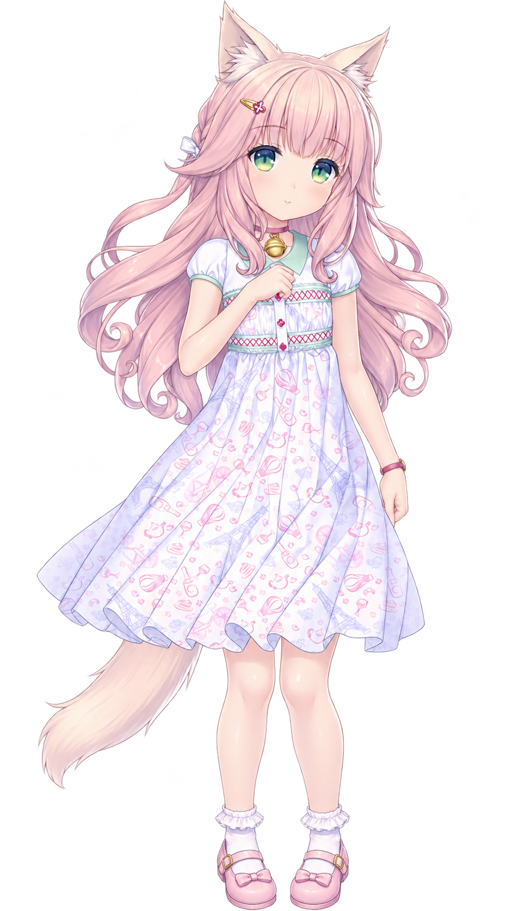

<table>
<tr>
<td align="center" valign="middle" width="310"></td>
<td valign="top">
<h1>Wextikit</h1>
Mostly C# and Lua stuff.

<h2>Technologies</h2>

         

<h2>Contact</h2>

 

</td>
</tr>
</table>
